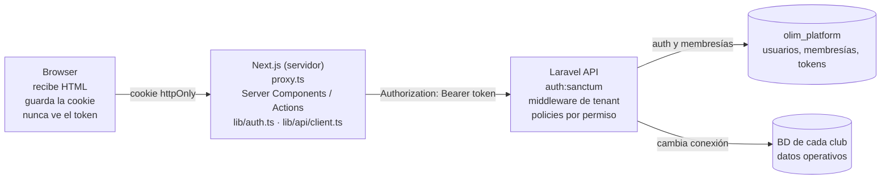
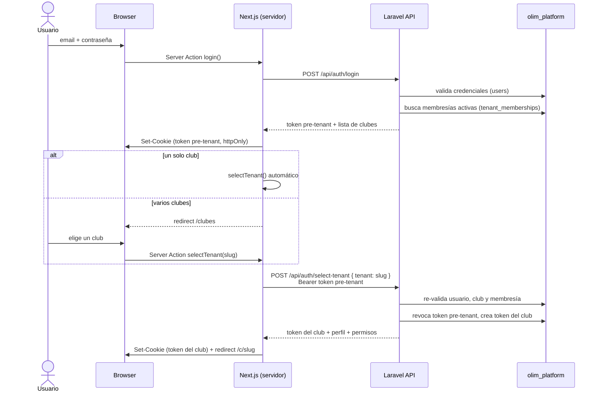

# Integración Frontend Next.js ↔ API Laravel

> Fuente de las decisiones: [ADR 0001](adr/0001-frontend-api-integration.md) (aceptado el 2026-10-15) y [ADR 0002](adr/0002-hosting-vercel-laravel-cloud.md) (hosting, propuesto).
> Este documento las desarrolla como contrato para quien construya la API en Laravel.

## 1. Contexto

- **Frontend:** este repo. Next.js 16 (App Router), React 19, TypeScript, Tailwind 4 y shadcn/ui. Por ahora es un prototipo: el login está hardcodeado en `lib/auth.ts` y los datos son mock (`lib/data.ts`, `lib/tenants.ts`).
- **Backend:** una sola aplicación Laravel, en otro repo. Es dueña de la lógica de negocio, la persistencia y la autenticación.
- **Datos:**
  - Una BD central `olim_platform`, con usuarios, clubes (`tenants`), membresías (`tenant_memberships`) y tokens.
  - Una BD MySQL por club, con los datos operativos.
- **Autorización:**
  - `tenant_memberships` es la única fuente de acceso a un club.
  - Los roles y permisos son por club (`roles`, `permissions`, `club_user_roles`).

## 2. Arquitectura: Backend-for-Frontend (BFF)

El browser solo habla con Next.js, y Next.js es el único cliente de Laravel. Así el token nunca llega al JavaScript del browser, y Laravel no necesita CORS ni cookies cross-site.



- Next.js corre como servidor, sin static export.
- La URL de Laravel se lee de `API_URL`, una variable server-only (sin el prefijo `NEXT_PUBLIC_`).
- Cada request suma un salto (browser → Next → Laravel). Por eso conviene desplegar los dos en la misma región o red.

## 3. Login, tokens y cookies

### 3.1 Respuesta corta

1. El usuario ingresa email y contraseña.
2. Las credenciales se validan contra la **BD central** (`olim_platform.users`), **no contra un club**. El usuario es global: existe una sola vez, aunque pertenezca a varios clubes.
3. Si las credenciales son válidas, Laravel devuelve:
   - un token **pre-tenant**, que solo sirve para elegir club;
   - la lista de clubes en los que el usuario tiene una membresía activa (`tenant_memberships`).
4. Con esa lista pasa lo siguiente:
   - **Un solo club:** el frontend lo elige automáticamente y el usuario entra directo, sin ver el selector.
   - **Varios clubes:** se muestra el selector `/clubes` y el usuario elige uno.
   - **Ningún club:** no puede entrar. Se muestra el mensaje "no tenés clubes asignados".
5. Al elegir el club, Laravel **vuelve a validar** la membresía y cambia el token pre-tenant por uno **atado a ese club**. Recién ahí el usuario entra a `/c/<club>`.

Es decir: autenticarse (quién sos) y autorizarse para un club (a qué club entrás) son dos pasos separados. El usuario recién "entra" después del segundo.

### 3.2 Diagrama de secuencia



### 3.3 Los dos tokens

| | Token pre-tenant | Token del club (tenant-scoped) |
| --- | --- | --- |
| Se emite en | `POST /auth/login` | `POST /auth/select-tenant` |
| `tenant_id` | `null` | el club elegido |
| Abilities | solo `tenant:select` | operación normal |
| Sirve para | elegir club, listar clubes | todos los endpoints operativos |
| Duración | corta (minutos), a definir | una jornada de trabajo, a definir |
| Se revoca | al elegir club o en el logout | al cambiar de club o en el logout |

Los dos son **Sanctum personal access tokens**. Son opacos, se guardan del lado del servidor y se pueden revocar en cualquier momento.

**Por qué existe el token pre-tenant**

Entre el login y la elección del club, Next.js tiene que demostrarle a Laravel quién es el usuario para pedir la lista de clubes y llamar a `select-tenant`. Hay tres formas de hacerlo:

| Opción | Problema |
| --- | --- |
| Reenviar email y contraseña en `select-tenant` | Next.js tendría que guardar la contraseña entre una pantalla y otra |
| Emitir un token "completo" sin club | Si se filtra, tiene el mismo alcance que una sesión normal, y la única barrera sería que cada endpoint verifique que el token tenga club |
| **Token pre-tenant** (elegida) | — |

El token pre-tenant aplica **mínimo privilegio**:

- Solo tiene la ability `tenant:select` y `tenant_id = null`, así que no puede leer ni modificar datos de ningún club, aunque alguien lo robe.
- Dura minutos y se revoca en cuanto se elige el club.
- La membresía se valida en el momento de elegir el club, no solo en el login. Si a alguien le quitan el acceso entre esos dos pasos, no entra.
- Cambiar de club reutiliza el mismo endpoint (`select-tenant`), sin un flujo aparte.

### 3.4 Después de entrar

- Cada request operativo sale de Next.js con `Authorization: Bearer <token>`.
- Laravel resuelve el club **a partir del token**, nunca desde la URL ni el body.
- El `[club]` de `/c/[club]` es solo navegación. Si no coincide con el club del token, el frontend redirige a `/clubes`.
- **Cambiar de club:** se llama de nuevo a `select-tenant`, que revoca el token actual y emite otro.
- **Logout:**
  1. Next.js llama a `POST /api/auth/logout` y Laravel revoca el token actual.
  2. Next.js borra la cookie, aunque la llamada haya fallado.
- **Trade-off aceptado:** un browser tiene un solo club activo a la vez, así que dos pestañas no pueden mostrar dos clubes distintos.

### 3.5 La cookie

| Atributo | Valor | Por qué |
| --- | --- | --- |
| Contenido | solo el token Sanctum | El perfil y los permisos se piden a `/me`, no viajan en la cookie |
| `httpOnly` | `true` | El JavaScript del browser no puede leerla, así que un XSS no roba el token |
| `secure` | `true` en producción | Solo viaja por HTTPS |
| `sameSite` | `lax` | No hay uso cross-site y agrega protección CSRF. Reemplaza el `none` actual del prototipo |
| `path` | `/` | Toda la app la necesita |
| `maxAge` / `expires` | igual al `expires_at` del token | La cookie y el token vencen juntos |

### 3.6 Expiración y errores de sesión

- Cada token tiene su propio `expires_at`. Sanctum lo acepta en `createToken(name, abilities, expiresAt)`.
- En la primera versión no hay refresh token ni renovación automática: cuando el token vence, el usuario vuelve a loguearse.
- Errores de sesión:

| Respuesta de Laravel | Qué hace el frontend |
| --- | --- |
| **401** (token vencido o revocado, usuario desactivado) | Borra la cookie y redirige a `/` |
| **403** `tenant_required`, `membership_inactive` o `tenant_inactive` | Redirige a `/clubes` |
| **403** `forbidden` (le falta un permiso) | Muestra un error sin cerrar la sesión |

## 4. Capas en el frontend

| Pieza | Ubicación | Qué hace | Qué no hace |
| --- | --- | --- | --- |
| Gate optimista | `proxy.ts` (en Next 16 reemplaza a `middleware.ts`) | Si no hay cookie, redirige a `/` | No llama a la API ni valida el token |
| Sesión / DAL | `lib/auth.ts` | `login`, `selectTenant`, `logout`, `requireSession()`. Son las únicas funciones que leen o escriben la cookie | No renderiza UI |
| Cliente API | `lib/api/client.ts` (`import 'server-only'`) | Lee la cookie, llama a `API_URL` y mapea 401, 403 y 422 | No se importa desde client components |
| Llamadas de dominio | `lib/api/<modulo>.ts` | Un archivo por módulo (jugadores, pedidos, inventario…) que devuelve datos tipados | No decide permisos |

Reglas:

- Los Server Components leen datos y los Server Actions hacen mutaciones. Los client components solo llaman a Server Actions.
- Nada que dependa del usuario se cachea entre usuarios: los fetch usan `cache: 'no-store'` y cada mutación llama a `revalidatePath`.
- Los permisos que devuelve la API solo sirven para mostrar u ocultar UI. Laravel los vuelve a verificar en cada endpoint.
- **CSRF:**
  - Los Server Actions de Next.js comparan `Origin` con `Host`.
  - La cookie `lax` no viaja en un POST cross-site.
  - Laravel no necesita protección CSRF, porque no recibe cookies.

## 5. Qué tiene que tener la API Laravel

### 5.1 Endpoints de autenticación

| Método y ruta | Token requerido | Body | Respuesta 2xx |
| --- | --- | --- | --- |
| `POST /api/auth/login` | ninguno | `email`, `password` | `token`, `expires_at`, `user` (`id`, `name`, `email`), `tenants[]` (`slug`, `name`) |
| `POST /api/auth/select-tenant` | pre-tenant o del club, del mismo usuario | `tenant` (slug) | `token`, `expires_at`, `tenant`, `profile`, `permissions[]` |
| `GET /api/me` | del club | — | `user`, `tenant`, `profile`, `permissions[]` |
| `GET /api/me/tenants` | cualquiera del usuario | — | `tenants[]` para el selector `/clubes` |
| `POST /api/auth/logout` | cualquiera | — | `204` y el token queda revocado |

### 5.2 Tokens Sanctum

- Una migración que agrega la columna `tenant_id` (nullable, FK a `tenants`) en `olim_platform.personal_access_tokens`.
- Un modelo propio que extiende `PersonalAccessToken`, registrado con `Sanctum::usePersonalAccessTokenModel()`.
- `select-tenant` revoca el token con el que lo llamaron antes de devolver el nuevo.
- Una tarea programada `sanctum:prune-expired` para limpiar los tokens vencidos.

### 5.3 Middleware de las rutas operativas

Se ejecuta en este orden, en cada request:

1. `auth:sanctum`: el token tiene que ser válido y no estar vencido. Si no, responde **401**.
2. El token tiene que tener `tenant_id`. Si es pre-tenant, responde **403** `tenant_required`.
3. Vuelve a validar que el usuario, el club y la membresía en `tenant_memberships` estén activos. Si algo falla, responde **403** `membership_inactive` o `tenant_inactive`.
4. Cambia la conexión a la BD del club (setear la config, `DB::purge()` y reconectar) y deja el tenant disponible para el resto del request.
5. Autoriza con policies o Gates contra las permission keys del rol del usuario en ese club (por ejemplo `orders.approve`). Si falta el permiso, responde **403** `forbidden`.

### 5.4 Formato de respuestas

| Caso | Status | Cuerpo |
| --- | --- | --- |
| No autenticado | 401 | `{ "message": "..." }` |
| Sin acceso | 403 | `{ "message": "...", "code": "tenant_required" \| "membership_inactive" \| "tenant_inactive" \| "forbidden" }` |
| Validación | 422 | Formato default de Laravel: `{ "message", "errors": { "campo": ["..."] } }` |
| Rate limit | 429 | `{ "message" }` y el header `Retry-After` |
| Listas | 200 | API Resources paginados: `{ data, links, meta }` |

Convenciones:

- Siempre responde JSON, también cuando hay excepciones (renderizado de errores para `api/*`).
- Las fechas van en ISO 8601 con zona horaria y las claves en `snake_case`.
- Los enums van en inglés, como en la BD (`pending`, `approved`…).
- El frontend usa el campo `code` de los 403 para decidir a dónde redirigir, así que tiene que ser estable.

### 5.5 Seguridad del lado Laravel

- `throttle` en `/auth/login`, y el mismo mensaje para un email inexistente que para una contraseña incorrecta.
- **Sin CORS:** el browser nunca llama a Laravel, así que no hay que habilitar orígenes ni configurar `SANCTUM_STATEFUL_DOMAINS`.
- Idealmente, la API solo es accesible desde el servidor de Next.js (red privada o allowlist).
- Nunca aceptar `tenant_id` ni el slug del club en el body o la URL como fuente de autorización.

### 5.6 Bases de datos por club

> Probado en Laravel Cloud: ver la evidencia en el [ADR 0002](adr/0002-hosting-vercel-laravel-cloud.md).

#### Dónde vive cada cosa

```
Cluster MySQL de Laravel Cloud (un servidor, mismo host y usuario)
├── olim_platform   ← base GENERAL, la única conectada al entorno (DB_DATABASE)
│     users, tenants, tenant_memberships, personal_access_tokens
├── club_river      ← la crea la API al dar de alta el club
│     jugadores, partidos, pedidos, roles, permissions...
└── club_boca
      jugadores, partidos, pedidos, roles, permissions...
```

- El entorno de Laravel Cloud se conecta **solo** a la base general.
- Las bases de los clubes aparecen en el dashboard, pero **nunca** se eligen en el selector de base del entorno: eso reemplazaría a la general como `DB_DATABASE`.
- La tabla `tenants` guarda, por cada club, el nombre de su base (`database_name`).

#### Configuración en Laravel

- `config/database.php` tiene dos conexiones:
  - `mysql`: la base general, con las variables que inyecta Laravel Cloud;
  - `tenant`: el mismo host, usuario y contraseña, con `database => null`. Se completa en cada request.
- Las migraciones están separadas:
  - `database/migrations/`: base general;
  - `database/migrations/tenant/`: bases de los clubes.
- Los modelos generales (`User`, `Tenant`, `TenantMembership`) usan la conexión por defecto. Los modelos del club declaran `protected $connection = 'tenant';`.

#### Alta de un club

Se hace con un comando administrativo (por ejemplo `php artisan tenants:create <slug> "<nombre>"`), no con un endpoint público:

1. **Validar el slug** con una regla estricta, por ejemplo `^[a-z0-9_]+$`. Es obligatorio: el nombre de una base no se puede pasar como parámetro en una consulta preparada, así que va concatenado en el SQL.
2. Insertar en `tenants` con `database_name = club_<slug>` y `status = provisioning`.
3. Ejecutar `CREATE DATABASE club_<slug>`.
4. Apuntar la conexión `tenant` a la nueva base y migrarla: `migrate --database=tenant --path=database/migrations/tenant --force`.
5. Cargar los roles y permisos iniciales del club (seeder).
6. Crear la membresía del administrador del club y pasar el club a `status = active`.

Si un paso falla, el club queda en `status = failed` y el comando se puede volver a correr sin duplicar nada (idempotente).

#### Cada request operativo

En el middleware de tenant (sección 5.3, paso 4):

```php
config(['database.connections.tenant.database' => $tenant->database_name]);
DB::purge('tenant'); // descarta la conexión anterior; la próxima consulta se conecta a la base nueva
```

**No usar `USE <base>`:** el proxy de Laravel Cloud lo rechaza (`SQL Error 1148`). Laravel no lo necesita, porque abre la conexión directamente con la base indicada.

#### Migraciones en cada deploy

Una migración de club tiene que aplicarse en **todas** las bases de los clubes. Los *deploy commands* de Laravel Cloud tienen que incluir los dos pasos:

```bash
php artisan migrate --force           # base general
php artisan tenants:migrate --force   # recorre los clubes activos y migra cada base
```

Reglas:

- **Migraciones compatibles hacia atrás.** Primero se agrega lo nuevo y recién en un deploy posterior se quita lo viejo. Si la migración falla a mitad de camino, algunos clubes quedan con el esquema nuevo y otros con el viejo, y el código tiene que funcionar con los dos.
- **`tenants:migrate` informa qué clubes migró y cuáles fallaron**, para poder reintentar solo esos.

#### Usuarios de la base de datos

El usuario por defecto del cluster puede crear bases en todo el cluster: si hay un SQL injection, el impacto sería alto. La propuesta es separar:

| Usuario | Permisos | Lo usa |
| --- | --- | --- |
| Operación | *Read-write* sobre las bases | La API en cada request |
| Provisión | Crear bases | Solo `tenants:create` |

Los usuarios se crean en **Database users** del cluster. A definir al construir la API.

#### Implementación propia o paquete

Paquetes como `stancl/tenancy` ya resuelven el cambio de conexión, el alta y las migraciones por club, pero imponen sus propias convenciones. Se decide en un ADR del repo de la API.

## 6. Contrato tipado

1. Laravel genera un documento OpenAPI con `dedoc/scramble`. Lo arma a partir de las rutas, los Form Requests y los API Resources, sin anotaciones a mano.
2. El frontend corre `openapi-typescript` contra ese documento y versiona los tipos generados.
3. Los archivos `lib/api/<modulo>.ts` usan esos tipos. Los componentes nunca tipan respuestas a mano.
4. Los enums viajan en inglés y el frontend los traduce a etiquetas en español, con un solo mapa por enum.

Para que scramble infiera bien los tipos, la API tiene que validar con Form Requests y responder con API Resources, no devolver modelos ni arrays sueltos.

## 7. Decisiones de producto pendientes

La UI muestra cinco cosas que el modelo de datos no guarda. Cada una necesita una decisión antes de conectar su pantalla a la API.

| Dato en la UI | Dónde está hoy | Qué dice el modelo | Decisión |
| --- | --- | --- | --- |
| Tabla de posiciones | `Standing` en `lib/data.ts` | No hay tablas de torneos ni de posiciones | pendiente |
| Objetivos de jugador | `Objective` en `lib/data.ts` | `player_goals` y `goal_progress_updates` se eliminaron a propósito | pendiente |
| Notas del entrenador | `CoachNote` en `lib/data.ts` | No hay una tabla equivalente | pendiente |
| Perfil del club (ciudad, fundación, color, socios) | `lib/tenants.ts` | `tenants` solo guarda nombre, slug y datos de conexión | pendiente |
| Estados de pedido | la UI usa 4 estados | el modelo tiene 7 (`draft` … `rejected`) | pendiente |

Opciones para cada una: quitar la pantalla, dejarla como "próximamente" o agregar la tabla al modelo. En los estados de pedido, la opción real es adaptar la UI a los 7 estados o agruparlos en 4 etiquetas.

## 8. Próximos pasos

**Laravel**

- [ ] Migración de `tenant_id` en `personal_access_tokens` y modelo de token propio
- [ ] `POST /auth/login`, `POST /auth/select-tenant`, `GET /me`, `GET /me/tenants`, `POST /auth/logout`
- [ ] Middleware de tenant (re-validación y cambio de conexión)
- [ ] Errores en JSON, con un `code` estable en los 403
- [ ] Documento OpenAPI publicado con scramble
- [ ] Conexión `tenant` y migraciones separadas (`database/migrations/tenant/`)
- [ ] Comandos `tenants:create` y `tenants:migrate`, y `tenants:migrate` en los deploy commands
- [ ] Usuarios de base separados para operación y provisión
- [ ] Definir la duración de los dos tokens

**Frontend**

- [ ] `lib/api/client.ts` server-only, con manejo de 401, 403 y 422
- [ ] Reescribir `lib/auth.ts` (login real, `selectTenant`, `logout`, `requireSession`) y pasar la cookie a `sameSite: lax`
- [ ] `proxy.ts` como gate optimista
- [ ] Generar los tipos con `openapi-typescript`
- [ ] Reemplazar los mocks de `lib/data.ts` y `lib/tenants.ts`, módulo por módulo

**Producto**

- [ ] Resolver las cinco decisiones de la sección 7
