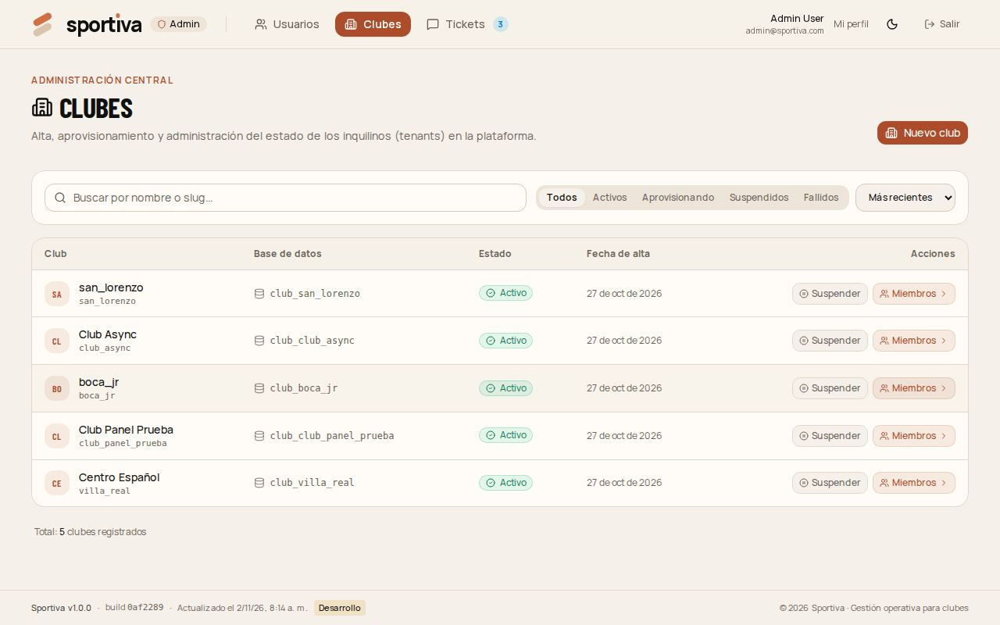
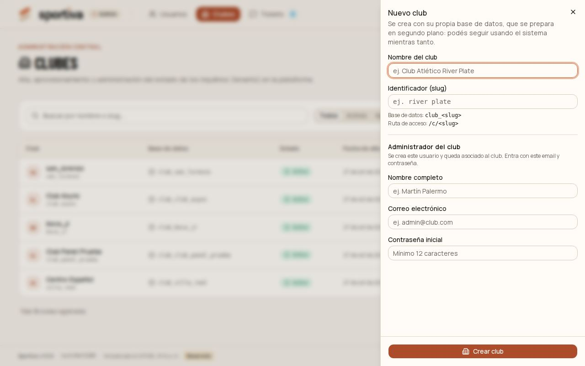
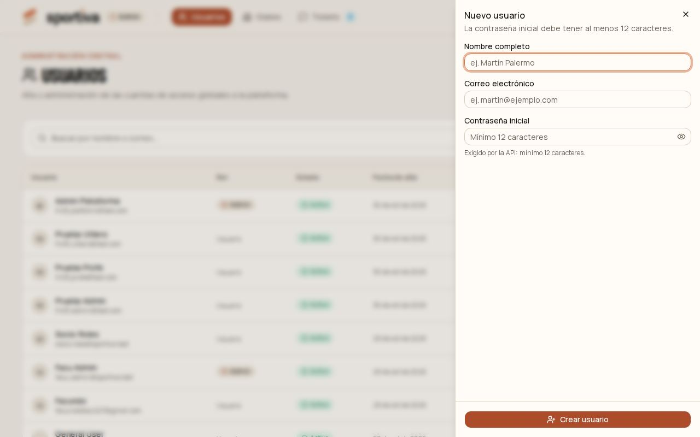

# 1. Admin de plataforma

Es el equipo de Sportiva. Entra a **/admin** (el panel de plataforma) con una cuenta de administrador y gestiona los clubes y los usuarios de todos los clubes. No opera dentro de un club.

[← Índice del manual](README.md)

## Dar de alta un club

1. Entrá a **Clubes** y tocá **Nuevo club**.
2. Completá:
   - **Nombre** del club.
   - **Slug:** el identificador corto, en minúsculas, números y guion bajo (por ejemplo `club_atletico_sur`). No se puede cambiar después: es parte de la dirección y del nombre de la base de datos.
   - **Administrador inicial:** nombre, email y contraseña de quien va a gestionar el club.
3. Tocá **Crear club**.

El club queda en **Aprovisionando** mientras se crea su base de datos (unos segundos) y después pasa a **Activo**. Si queda en **Fallido**, tocá **Reintentar**.

Desde ese momento, el administrador del club entra con su email y su contraseña y arma el resto (ver el [capítulo 2](02-admin-del-club.md)).

## Editar un club o darlo de baja

1. En **Clubes**, entrá al club.
2. **Editar club:** nombre, sigla, ciudad, año de fundación y color.
3. **Suspender** (desde el listado): nadie del club puede entrar, pero los datos quedan. Se reactiva cuando quieras.
4. **Dar de baja:** el club deja de aparecer y nadie puede entrar. Para confirmar, hay que escribir el slug del club. La base de datos no se borra.

## Usuarios

- **Nuevo usuario:** nombre, email y una contraseña inicial de 12 caracteres o más. Después podés **Asociar** el usuario a uno o más clubes, eligiendo sus roles.
- **Editar:** nombre y email. Desde ahí también **Enviar mail para restablecer** la contraseña.
- **Desactivar:** el usuario no puede entrar a ningún club. No se borra.

Lo habitual es que cada club sume a su propia gente desde **Equipo** (capítulo 2). El panel de plataforma es para el alta inicial y para resolver casos puntuales.

## Miembros y roles de un club

Dentro de un club, la sección **Miembros** muestra quién tiene acceso y con qué roles. Desde ahí se suma gente, se cambian roles y se quita el acceso. También se pueden crear **roles propios** del club, copiando uno estándar y ajustando sus permisos.

## Tickets

**Tickets** reúne las consultas que llegan desde el formulario de contacto del sitio público. En cada una se ve el detalle y se le cambia el estado a medida que se atiende.
