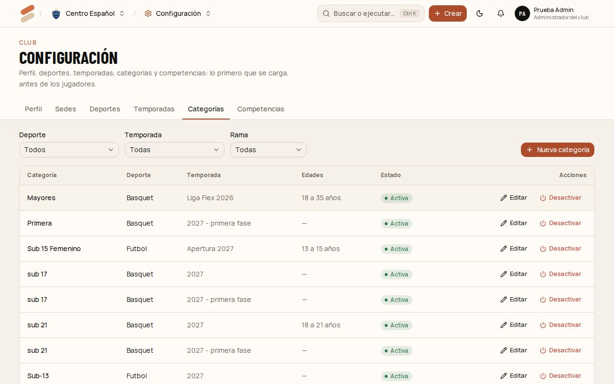
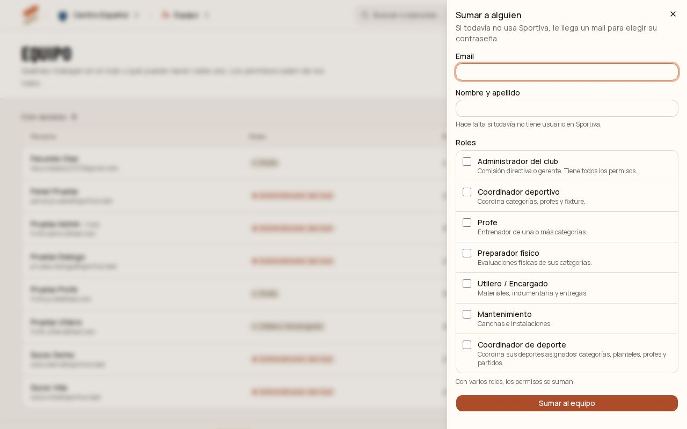
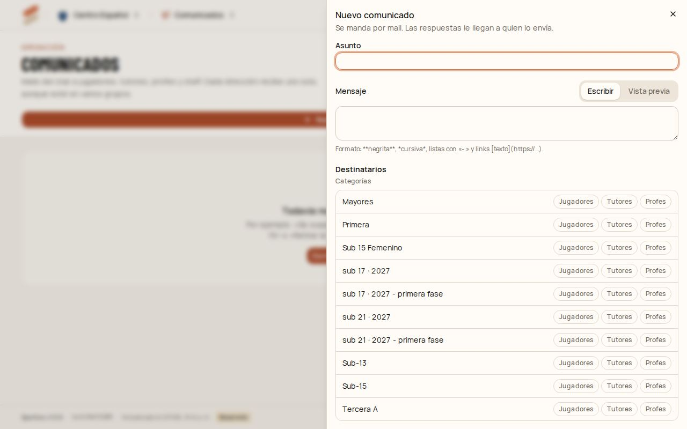
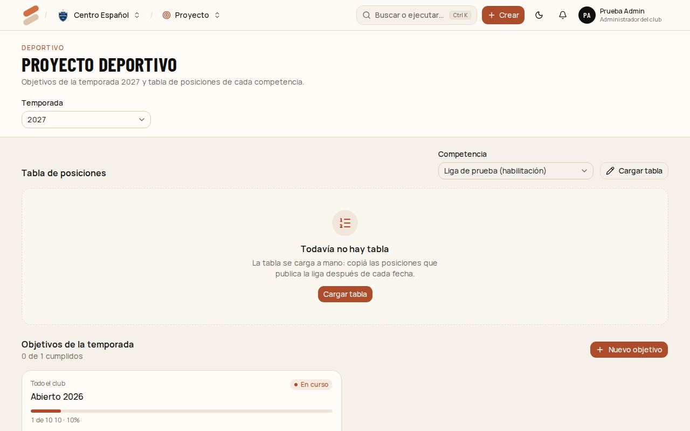

# 2. Administrador del club

Tiene todos los permisos dentro de su club. Además de lo de este capítulo, puede hacer todo lo que hacen el coordinador, el profe, el utilero y mantenimiento (capítulos 3 a 7).

[← Índice del manual](README.md)

## Configurar el club (la primera vez)

Arriba a la derecha aparece **Configurar club 0/3**: es la guía de primeros pasos. Entrá a **Configuración** (en el selector de módulos) y cargá, en este orden:

1. **Perfil:** nombre, sigla, ciudad, año de fundación, color y escudo.
2. **Sedes:** dónde juega el club de local. Escribí la dirección y elegí la sugerencia: queda el punto en el mapa y el link de "Cómo llegar".
3. **Deportes:** los que tiene el club.
4. **Temporadas:** por ejemplo "2027". Marcala **Activa** cuando empiece.
5. **Categorías:** cada una es de un deporte y una temporada. Opcional: edades y **rama** (Femenino, Masculino o Mixto). Con rama femenina o masculina, el sistema avisa si se suma a un jugador de otro género.
6. **Competencias:** la liga o el torneo, sus categorías y los **papeles** que pide para estar habilitado (ficha federativa, apto médico con vencimiento, DNI, autorización de los padres solo para menores…).

**Dos competencias iguales para ramas distintas** (por ejemplo, la misma liga en Sub 21 femenino y masculino): cargá una, después tocá **Duplicar**, elegí la misma temporada y cambiale la categoría. Los papeles se copian.

## Sumar gente al equipo

1. Entrá a **Equipo** y tocá **Sumar a alguien**.
2. Escribí el **email**. Si la persona todavía no usa Sportiva, escribí también su **nombre y apellido**.
3. Elegí uno o más **roles**. Cada uno dice qué puede hacer. Para un **coordinador de deporte**, elegí además qué deportes coordina.
4. Tocá **Sumar al equipo**. Si es nueva, le llega un mail para elegir su contraseña.

Desde la lista:

- **Roles:** cambiar los roles de alguien.
- **Quitar acceso:** deja de poder entrar al club. Su historial (partidos, asistencias, pedidos) queda. **Devolver acceso** lo revierte.

El club nunca se queda sin administrador: si sos el único, el sistema no te deja sacarte el rol. Sumá otro administrador antes.

Para que un **profe** vea sus categorías, además de darle el rol hay que asignarle las categorías en **Profes** (ver el [capítulo 3](03-coordinador.md#profes-y-categorías-a-cargo)).

## Mandar un comunicado

1. Entrá a **Comunicados** y tocá **Nuevo comunicado**.
2. Escribí el **asunto** y el **mensaje**. Admite **negrita**, *cursiva*, listas con "- " y links. En **Vista previa** se ve el mail tal como llega.
3. Elegí los **destinatarios**:
   - por categoría: **Jugadores**, **Tutores** y/o **Profes**;
   - jugadores sueltos, con el buscador;
   - staff, por rol o por persona.
4. Abajo se ve **"Llega a N personas"** y quiénes no tienen email cargado.
5. Tocá **Enviar…** y confirmá. También podés **Guardar borrador** y enviarlo después.

Cada dirección recibe un solo mail, aunque esté en varios grupos (un tutor con dos hijos). Las respuestas le llegan a quien lo envió. En el historial se ve cuántos se entregaron y cuáles fallaron.

Atajos: en un partido, **Avisar a la categoría**; en un pedido de indumentaria entregado, **Avisar retiro**.

## Aprobar pedidos

En **Indumentaria**, los pedidos que mandan los profes aparecen como **Para aprobar** (también en el inicio, en **Pedidos**). Abrí el pedido y tocá **Aprobar** o **Rechazar pedido** (con el motivo). Al aprobar o rechazar, a quien lo pidió le llega un aviso en la campanita.

## Proyecto deportivo

En **Proyecto**:

- **Tabla de posiciones:** elegí la competencia y tocá **Cargar tabla**. Ordená los equipos del primero al último, cargá partidos jugados, ganados, empatados, perdidos, goles y puntos, y marcá cuál es tu club. Se carga a mano después de cada fecha, copiando lo que publica la liga.
- **Objetivos de la temporada:** **Nuevo objetivo**, del club o de una categoría, con una meta y su avance (por ejemplo "8 partidos ganados", avance 2). El porcentaje se calcula solo.

Si hay varias temporadas activas, elegí cuál arriba.
