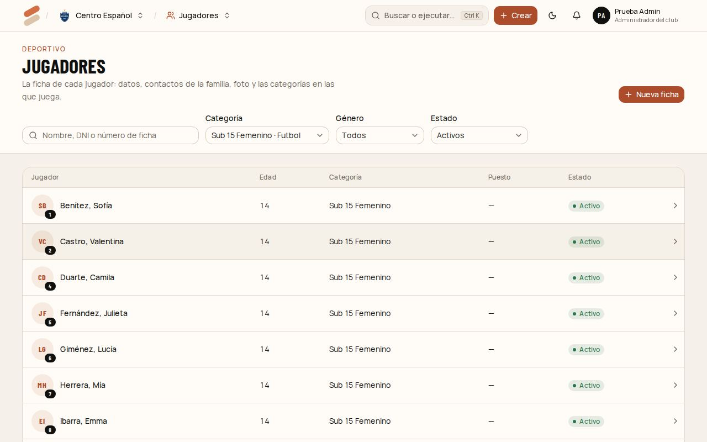
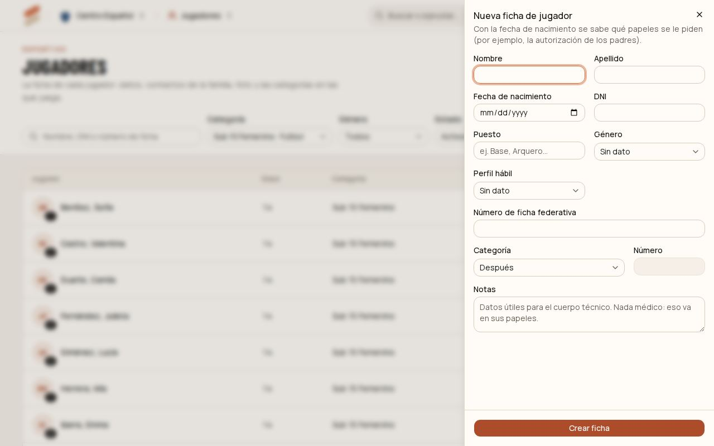
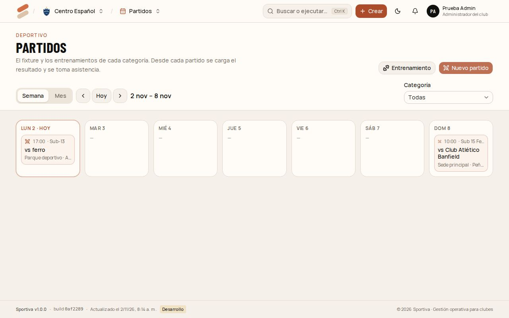
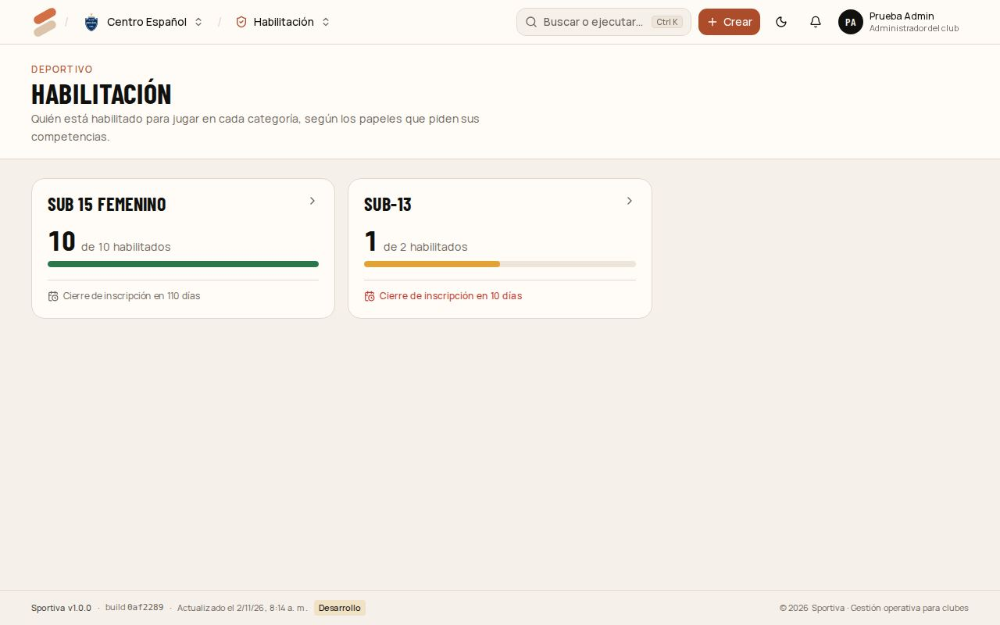
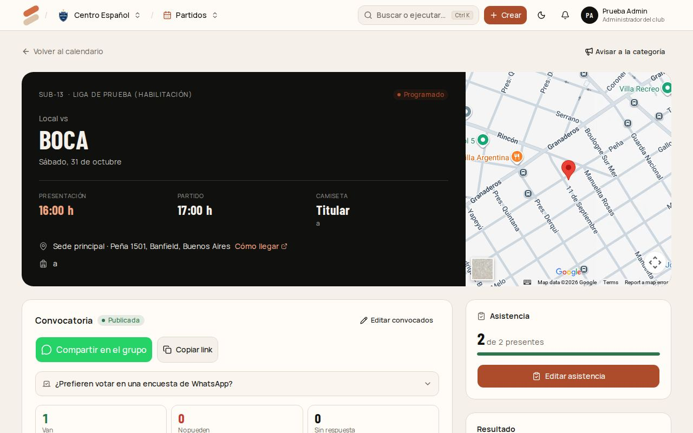

# 3. Coordinador

Hay dos coordinadores:

- **Coordinador deportivo:** todo el club. Jugadores, profes, fixture, habilitación, convocatorias, configuración deportiva, aprobar indumentaria y comunicados.
- **Coordinador de deporte:** lo mismo, pero solo en los deportes que tiene asignados (por ejemplo, solo fútbol).

[← Índice del manual](README.md)

## Dar de alta un jugador

1. Entrá a **Jugadores** y tocá **Nueva ficha**.
2. Completá **Nombre**, **Apellido** y **Fecha de nacimiento** (obligatorios). Con la fecha, el sistema sabe qué papeles se le piden: por ejemplo, la autorización de los padres si es menor.
3. Opcionales: **DNI**, **Puesto**, **Género**, **Perfil hábil**, **Número de ficha federativa** y **Notas** (datos útiles para el cuerpo técnico; nada médico).
4. En **Categoría**, elegí en cuál juega y su **Número** de camiseta, o dejá "Después".
5. Tocá **Crear ficha**. Se abre la ficha del jugador.

En la ficha podés seguir con:

- **Contactos:** **Nuevo contacto**, con nombre, relación (madre, padre, tutor o el mismo jugador), teléfono y email. Los emails sirven para los comunicados y el aviso de la convocatoria.
- **Foto.**
- **Sumar a una categoría.** Si ya está en otra del mismo deporte, marcá **Pase de categoría**: la anterior queda en su historial.
- **Papeles:** los que le piden sus competencias (ver [Habilitación](#habilitación)).

## Profes y categorías a cargo

1. Entrá a **Profes** y tocá **Nuevo profe** (nombre, teléfono y email).
2. En su ficha, **Asignar categoría**. El profe ve solo esas categorías.
3. Para que pueda entrar al sistema, el administrador lo suma en **Equipo** con el rol **Profe** (ver el [capítulo 2](02-admin-del-club.md#sumar-gente-al-equipo)).

## Cargar el fixture

1. Entrá a **Partidos**. El calendario muestra la semana o el mes.
2. Tocá **Nuevo partido**: categoría, competencia, rival, fecha y hora, local o visitante, sede (de local, la API completa la dirección y el link de Maps), hora de presentación, camiseta (titular o alternativa) y qué llevar.
3. Tocá **Cargar partido**.
4. Para los entrenamientos, **Entrenamiento**: categoría, día, horario y lugar.

Después del partido, en su página se carga el **resultado**.

## Habilitación

**Habilitación** muestra, por categoría, cuántos jugadores están habilitados y cuándo cierra la inscripción. Entrá a una categoría para ver los papeles de cada jugador:

1. Tocá el papel de un jugador.
2. **Presentar el papel:** subí el archivo (si lo pide) y la fecha.
3. Revisalo y tocá **Aprobar**, o rechazalo con el motivo.
4. Los papeles que vencen (por ejemplo el apto médico) se **renuevan** antes del vencimiento. Un mes antes aparece el aviso en la campanita.

Un jugador está habilitado cuando tiene aprobados todos los papeles obligatorios de las competencias de su categoría. Solo se convoca a jugadores habilitados.

## Convocatoria

1. En la página del partido, en **Convocatoria**, elegí a los convocados (**Todos los habilitados** o uno por uno). Los que no están habilitados aparecen en gris con lo que les falta.
2. Tocá **Guardar y publicar**. A los contactos con email les llega el aviso por mail.
3. **Compartir en el grupo** abre WhatsApp con el mensaje armado: lista de convocados, horario, lugar y un link.
4. Cada familia toca el link, busca su nombre y responde **Voy** o **No puedo**. Arriba se ven los contadores (**Van**, **No pueden**, **Sin respuesta**).
5. **Recordar a los que no respondieron** reenvía el aviso solo a ellos.

Si cambiás la fecha, la hora o el lugar después de publicar, aparece **"Hubo cambios: volvé a avisar"**.

## Comunicados y pedidos

- **Comunicados:** igual que el administrador ([capítulo 2](02-admin-del-club.md#mandar-un-comunicado)). El coordinador de deporte solo ve las categorías de sus deportes.
- **Aprobar indumentaria:** el coordinador deportivo aprueba o rechaza los pedidos de indumentaria, igual que el administrador ([capítulo 2](02-admin-del-club.md#aprobar-pedidos)).
