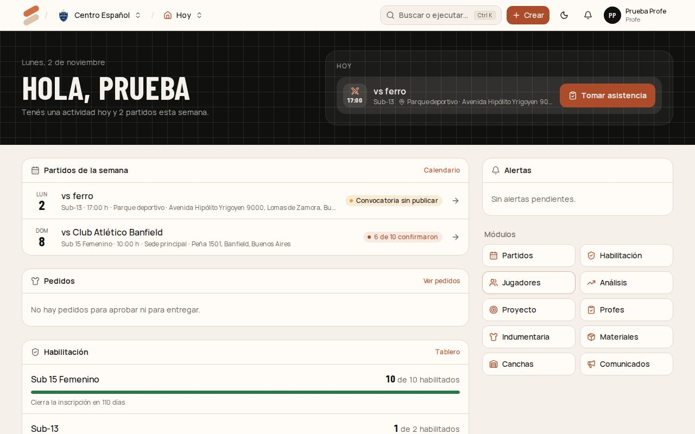
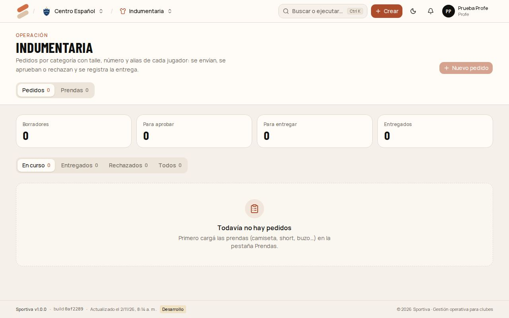

# 4. Profe

El profe trabaja con **sus categorías**: las que tiene asignadas en **Profes**. No ve las demás. Los jugadores los da de alta el coordinador o el administrador ([capítulo 3](03-coordinador.md#dar-de-alta-un-jugador)).

[← Índice del manual](README.md)

## Tu día

El **inicio** muestra lo de hoy (con **Tomar asistencia**), los partidos de la semana con el estado de cada convocatoria y los avisos: convocatorias sin publicar a 48 horas del partido, jugadores que faltan seguido y papeles por vencer.

En el celular, la barra de abajo tiene **Hoy**, **Calendario**, **Jugadores** y **Más**.

## Cargar entrenamientos y partidos

En **Partidos**:

- **Entrenamiento:** categoría, día, horario y lugar.
- **Nuevo partido:** categoría, rival, fecha y hora, local o visitante, sede, hora de presentación, camiseta y qué llevar. Tocá **Cargar partido**.

## Convocar

1. Abrí el partido desde el calendario.
2. En **Convocatoria**, elegí a los convocados. Solo se puede convocar a los habilitados; los demás aparecen en gris con lo que les falta.
3. Tocá **Guardar y publicar** y después **Compartir en el grupo**: se abre WhatsApp con el mensaje y el link para responder.
4. Mirá quién respondió (**Van**, **No pueden**, **Sin respuesta**). Si cambia algo del partido, el sistema te avisa que vuelvas a avisar.

El paso a paso completo está en el [capítulo 3](03-coordinador.md#convocatoria).

## Tomar asistencia (en 10 segundos)

1. Tocá **Tomar asistencia** en el inicio, o abrí el partido o el entrenamiento → **Editar asistencia**.
2. Un toque en el jugador lo marca **Presente**; otro toque, **Ausente**. Para **Tarde** o **Justificado**, usá los botones de su fila.
3. Los que respondieron "No puedo" en la convocatoria ya aparecen como **Justificado**, con su motivo.
4. Tocá **Guardar asistencia**.

**Sin señal en la cancha:** lo que marcaste queda guardado en el celular. Cuando vuelve la conexión, se guarda solo o con **Reintentar**.

## Pedir indumentaria

1. Entrá a **Indumentaria** y tocá **Nuevo pedido**.
2. Elegí la **Categoría** y la **Prenda**. Aparece el plantel.
3. Marcá a los jugadores y completá **talle**, **número**, **alias** y **cantidad**. **Talle para todos** carga el mismo en todos.
4. Elegí la **Prioridad** y tocá **Enviar para aprobar** (o **Guardar borrador** para seguir después).

Cuando lo aprueban, lo rechazan o lo entregan, te llega el aviso a la campanita. En el pedido se ve todo el historial.

## Reportar un problema en una cancha

En **Canchas**, tocá **Reportar problema**: la instalación, el elemento (por ejemplo, el aro norte), qué pasa y si se puede seguir usando. Le llega a mantenimiento.

## Avisar a tu categoría

En **Comunicados** podés escribirles a los jugadores, los tutores o los profes de tus categorías ([cómo](02-admin-del-club.md#mandar-un-comunicado)). Desde un partido, **Avisar a la categoría** abre el comunicado con el asunto cargado.

## Papeles de tus jugadores

En **Habilitación** ves qué le falta a cada jugador de tus categorías y podés **presentar** los papeles (subir el archivo). La aprobación la hace el coordinador.

## Análisis

En **Análisis** ves la asistencia, los resultados y la evolución física de tus categorías ([capítulo 5](05-preparador-fisico.md#el-tablero-de-la-categoría)).
