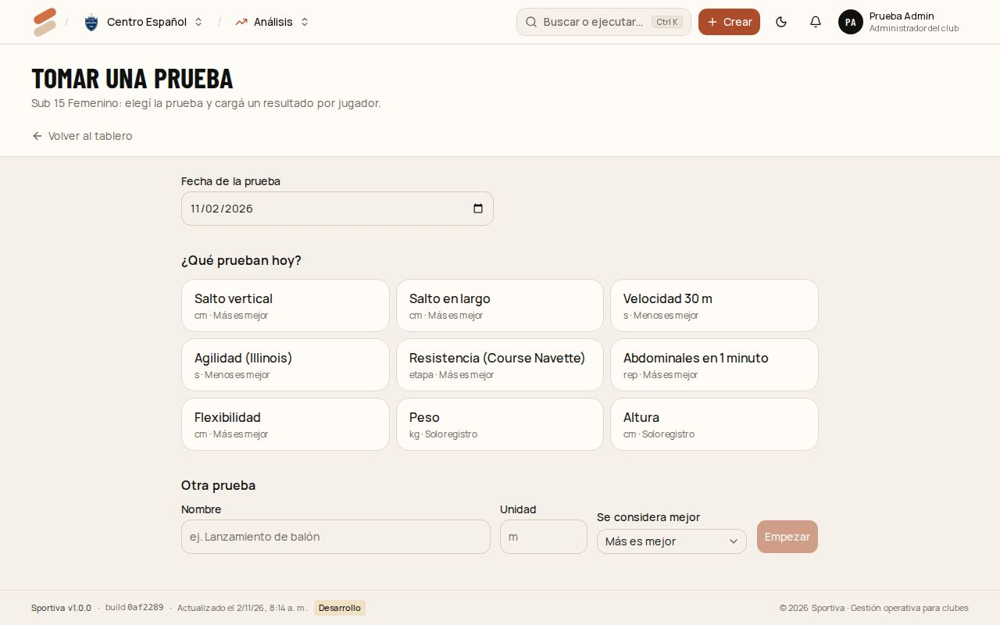
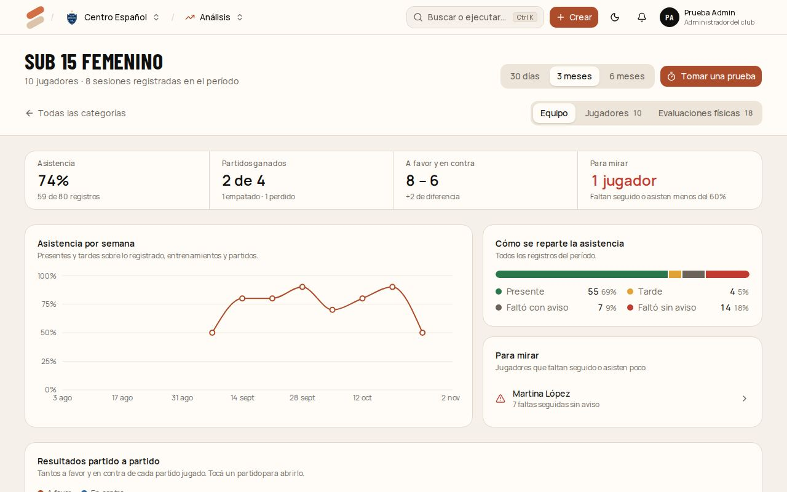

# 5. Preparador físico

Carga y sigue las **evaluaciones físicas** de sus categorías. El profe y el coordinador las ven, pero no las cargan.

[← Índice del manual](README.md)

## Tomar una prueba en vivo

Para cuando evaluás a toda la categoría el mismo día ("hoy, salto vertical para la Sub-15"). Funciona en la compu o en una tablet.

1. Entrá a **Análisis**, elegí la categoría y tocá **Tomar una prueba**.
2. Elegí la **fecha** y la prueba con un toque: salto vertical, salto en largo, velocidad 30 m, agilidad, Course Navette, abdominales en 1 minuto, flexibilidad, peso o altura. Si es otra, cargala en **Otra prueba** con su unidad y si **más** o **menos** es mejor.
3. Aparece una fila por jugador. Escribí el resultado y apretá **Enter** para pasar al siguiente. **No la hizo** lo saltea.
4. Al lado de cada uno ves su **resultado anterior** y si mejoró (verde) o empeoró (rojo). En velocidad, menos es mejor.
5. Abajo ves cuántos cargaste. Tocá **Guardar N resultados**.

Al guardar ves el promedio, la mejor marca, cuántos mejoraron y el ranking del día.

Si se cierra la pestaña o se corta la conexión, lo cargado queda guardado en el dispositivo: al volver aparece **"Recuperamos lo que habías cargado"**.

## Una evaluación completa de un jugador

En **Análisis** → la categoría → **Evaluaciones físicas** → **Nueva evaluación**: el jugador, la fecha, varias pruebas a la vez, un resumen y recomendaciones.

## El tablero de la categoría

**Análisis** muestra la tabla de categorías. Tocá una para ver su tablero, en el período que elijas (30 días, 3 meses o 6 meses):

- **Equipo:**
  - asistencia;
  - partidos ganados;
  - tantos a favor y en contra;
  - jugadores para mirar (los que faltan seguido o asisten menos del 60 %);
  - la asistencia semana a semana;
  - cómo se reparte la asistencia;
  - los resultados partido a partido.
- **Jugadores:** la asistencia de cada uno (se puede ordenar por menor asistencia). Tocá un jugador para ver su ficha: su asistencia y un gráfico de evolución por cada prueba física.
- **Evaluaciones físicas:** todas las cargadas, para editar o eliminar.
