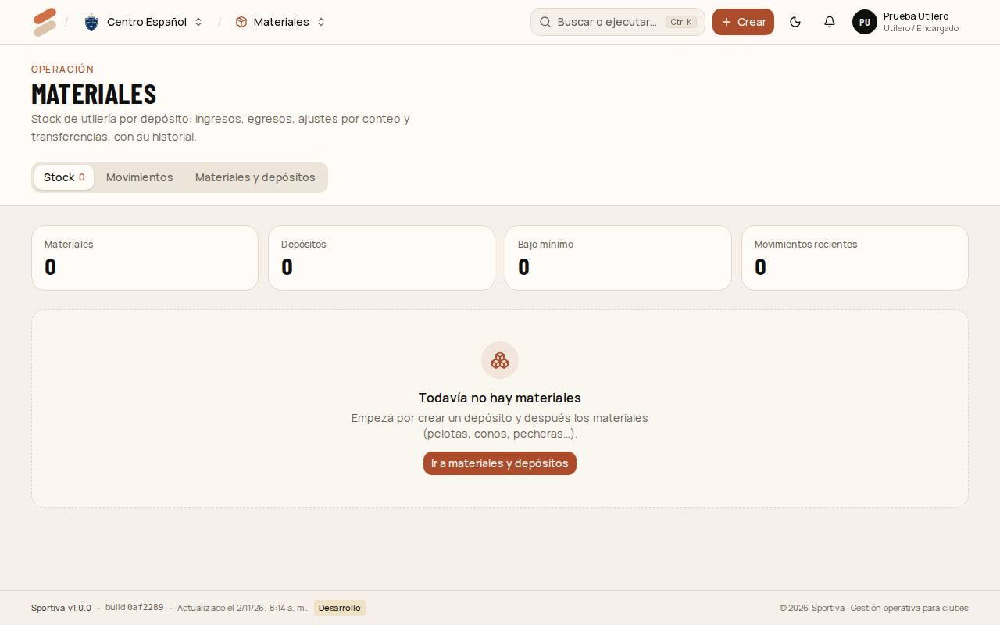
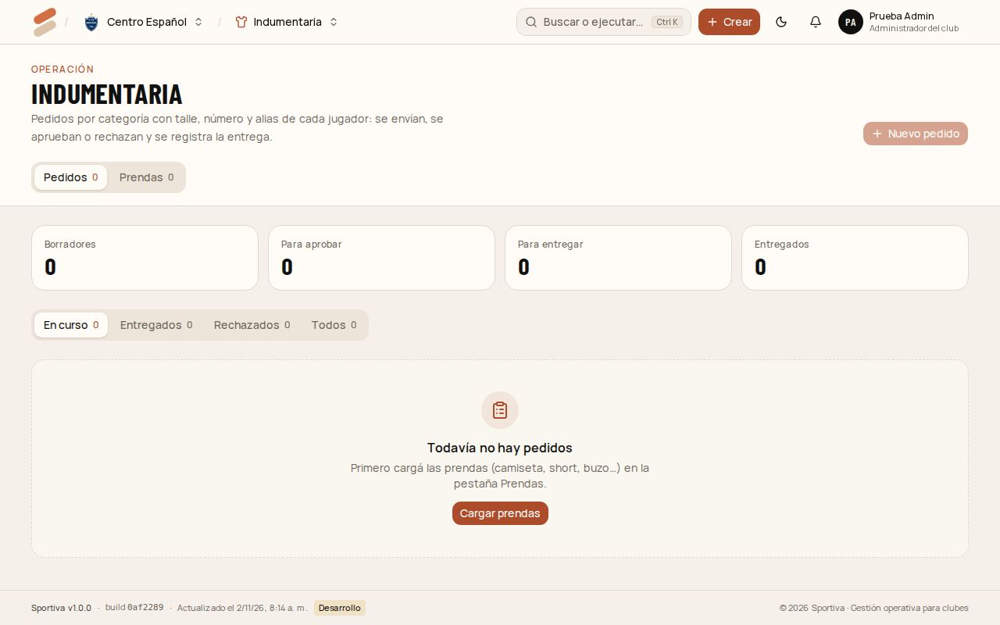

# 6. Utilero / Encargado

Lleva el **stock de materiales** (pelotas, conos, pecheras…) por depósito, el catálogo de **prendas** y las **entregas** de indumentaria.

[← Índice del manual](README.md)

## Cargar materiales y depósitos (la primera vez)

1. Entrá a **Materiales** → **Materiales y depósitos**.
2. **Nuevo depósito:** por ejemplo "Pañol de la sede" o "Parque deportivo".
3. **Nuevo material:** nombre, código y **stock mínimo**. Cuando el stock baja del mínimo, aparece en el inicio en **Stock bajo**.

## Movimientos de stock

En **Materiales**, tocá **Registrar movimiento**:

- **Ingreso:** llegó material (una compra o una donación).
- **Egreso:** salió material (se rompió, se perdió o se entregó).
- **Ajuste por conteo (Contar):** contaste lo que hay y cargás la cantidad real. El sistema calcula la diferencia.
- **Transferir:** mover material de un depósito a otro.

Cada movimiento queda en **Movimientos**, con fecha, quién lo hizo y el motivo. No se puede dejar el stock en negativo.

## Prendas

En **Indumentaria** → **Prendas** cargás el catálogo: camiseta titular, alternativa, short, buzo… con su descripción. Los profes eligen de esa lista al pedir.

## Entregar indumentaria

1. En **Indumentaria**, filtrá los pedidos **Para entregar** (ya aprobados).
2. Abrí el pedido y tocá **Entregar todo**, o cargá cuánto entregaste de cada línea si es una entrega parcial.
3. Agregá un comentario si hace falta ("Faltan dos talles M") y tocá **Guardar entrega**.

El pedido pasa a **Entregado** (o **Entrega parcial**) y a quien lo pidió le llega el aviso. Para avisarles a las familias que pasen a retirar, usá **Avisar retiro** en el pedido.
