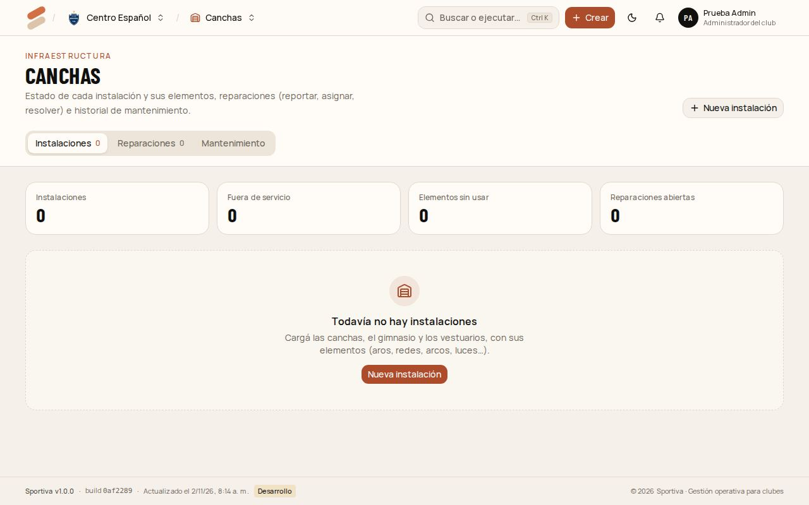

# 7. Mantenimiento

Cuida las **canchas e instalaciones**: carga sus elementos, recibe los problemas que reportan los demás, los asigna, los resuelve y registra el mantenimiento.

[← Índice del manual](README.md)

## Cargar las instalaciones

1. Entrá a **Canchas** y tocá **Nueva instalación**: nombre (por ejemplo "Cancha 1"), tipo y ubicación.
2. En la tarjeta de la instalación, **Agregar elemento**: aro norte, red, iluminación, tableros…
3. Cada elemento tiene un estado: **OK**, **Revisar** o **Fuera de servicio**. Se cambia desde la tarjeta.

## Reparaciones

Cualquiera del club puede **Reportar problema**. Vos lo ves en **Reparaciones**:

1. Abrí la reparación.
2. **Asignar:** elegí quién se ocupa. Le llega el aviso.
3. Cuando está arreglado, tocá **Resolver**: qué se hizo y el costo. Tocá **Marcar resuelta**.

A quien la reportó le llega el aviso, y el arreglo queda en el historial de **Mantenimiento**.

## Mantenimiento programado

En **Mantenimiento** registrás lo que se hace aunque no haya un problema: corte de pasto, pintura, revisión de la iluminación. Con fecha, quién y el costo.
