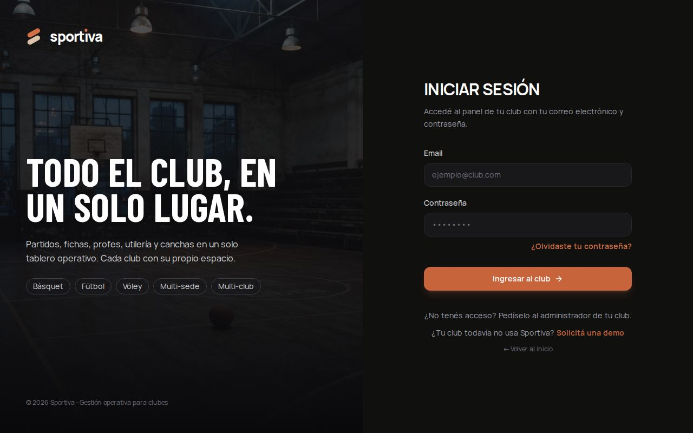
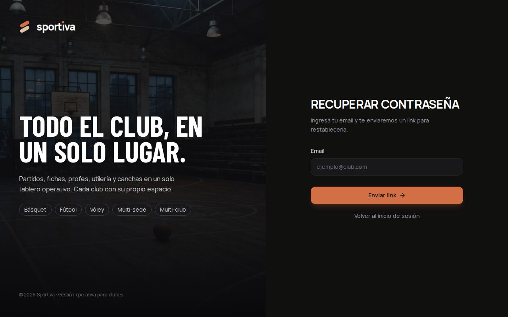
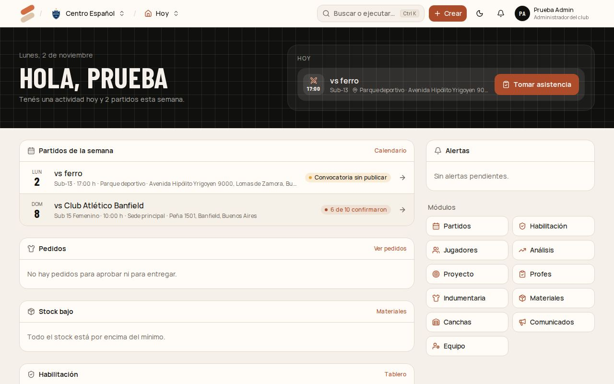

# Manual de Sportiva

Guía para quien usa el sistema en el club. Cada capítulo es un rol, con las tareas de todos los días paso a paso. Si tenés más de un rol, leé los capítulos de cada uno: los permisos se suman.

| Capítulo | Para quién |
| --- | --- |
| [1. Admin de plataforma](01-admin-plataforma.md) | El equipo de Sportiva: da de alta los clubes |
| [2. Administrador del club](02-admin-del-club.md) | La comisión o quien gestiona el club. Puede todo dentro de su club |
| [3. Coordinador](03-coordinador.md) | Coordinador deportivo (todo el club) y coordinador de deporte (sus deportes) |
| [4. Profe](04-profe.md) | Entrenador de una o más categorías |
| [5. Preparador físico](05-preparador-fisico.md) | Evaluaciones físicas de sus categorías |
| [6. Utilero / Encargado](06-utilero.md) | Materiales, indumentaria y entregas |
| [7. Mantenimiento](07-mantenimiento.md) | Canchas, instalaciones y reparaciones |
| [8. Familias y jugadores](08-familias.md) | Responden la convocatoria sin cuenta |

Las capturas son de un club de ejemplo, con datos inventados.

---

## Primeros pasos (todos los roles)

### Entrar

1. Abrí Sportiva y tocá **Ingresar al club**.
2. Escribí tu email y tu contraseña.
3. Si estás en más de un club, elegí con cuál vas a trabajar. Para cambiar después, tocá el nombre del club arriba a la izquierda.

**Si es la primera vez:** el administrador del club te sumó con tu email y te llegó un mail para elegir tu contraseña. Seguí el link del mail.

### Olvidé mi contraseña

1. En la pantalla de ingreso, tocá **¿Olvidaste tu contraseña?**
2. Escribí tu email y tocá **Enviar link**.
3. Abrí el mail de Sportiva y seguí el link. Elegí una contraseña nueva de 12 caracteres o más.

El link vence en una hora. Si venció, pedí otro.

### Moverse por el club

- **Inicio (Hoy):** lo que pasa hoy (con **Tomar asistencia** si hay actividad), los partidos de la semana, pedidos pendientes, stock bajo, habilitación y alertas.
- **Módulos:** abajo a la derecha en el inicio, o en el selector de arriba (al lado del nombre del club). Cada persona ve solo los módulos de sus roles.
- **Buscar (Ctrl + K):** jugadores, módulos y acciones rápidas.
- **Crear:** el botón de arriba abre las altas más comunes (partido, jugador, pedido…).
- **Campanita:** avisos del sistema (convocatorias sin publicar, papeles por vencer, jugadores que faltan seguido, pedidos aprobados…). Tocá un aviso para ir directo.
- **En el celular:** la barra de abajo tiene Hoy, Calendario, Jugadores y Más.

### Mi perfil

Desde tu nombre (arriba a la derecha) → **Mi perfil**:

- cambiar tu nombre;
- cambiar tu contraseña (te pide la actual; se cierran tus sesiones en otros dispositivos);
- ver tus clubes y tu rol en cada uno;
- **Cerrar las demás sesiones**, si entraste desde una compu prestada o perdiste el celular.

---

## Glosario

| Palabra | Qué es |
| --- | --- |
| **Club** | Cada institución tiene su espacio en Sportiva, con sus datos separados de los demás clubes |
| **Deporte** | Básquet, fútbol, vóley… Cada categoría es de un deporte |
| **Temporada** | Un período de juego (por ejemplo "2027" o "2027 - primera mitad"). Las categorías pertenecen a una temporada; el año siguiente se crean de nuevo y la historia queda |
| **Categoría** | Un plantel dentro de un deporte y una temporada: Sub-13, Sub-15 Femenino, Primera. Puede tener **rama** (femenino, masculino o mixto) |
| **Competencia** | Una liga o torneo, con sus categorías y los papeles que pide para jugar |
| **Habilitación** | Si un jugador tiene aprobados los papeles que piden las competencias de su categoría |
| **Membresía** | Que un jugador esté en una categoría (con su número de camiseta). Un "pase de categoría" cierra la anterior y abre la nueva |
| **Rol** | Lo que puede hacer una persona en el club: Administrador, Coordinador, Profe, Preparador físico, Utilero, Mantenimiento. Se pueden combinar |
| **Alcance** | Hasta dónde llega un rol: todo el club, sus deportes (coordinador de deporte) o sus categorías (profe y preparador) |
| **Convocatoria** | La lista de convocados a un partido, que se comparte por WhatsApp con un link para responder |
